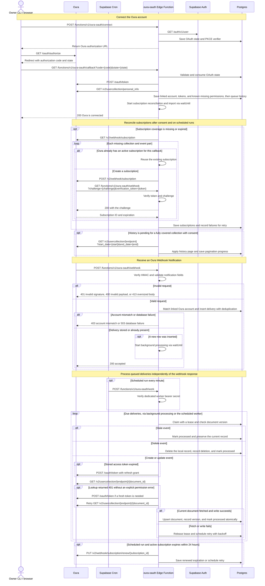

# Oura webhook flow

The paths below are relative to the receiving host. The diagram uses the default
Supabase webhook path. `OURA_WEBHOOK_URL` can override the callback URL
registered with Oura.

Each collection has separate `create`, `update`, and `delete` subscriptions.
For VO₂ Max, the webhook collection is `vo2_max` and the GET endpoint is
`vO2_max`. Requests include `fields` where the endpoint supports field
selection. History requests add `next_token` when continuing a paginated
result. Missing permissions appear as `consent_required` for the affected
history collections.

On each run, the scheduled worker processes deliveries, renews subscriptions,
prunes deliveries processed more than seven days ago, and advances repair and
initial sync in parallel. Initial sync reconciles subscriptions before importing
history.

| Owner action | Relative URL |
| --- | --- |
| Check subscription coverage, queued deliveries, and sync status | `GET /functions/v1/oura-oauth/status` |
| Reconcile subscriptions and advance history on demand | `POST /functions/v1/oura-oauth/import` |
| Recover changes missed during an outage | `POST /functions/v1/oura-oauth/repair` |

[Rollout guide](rollout.md) ·
[Edge Function handler](../supabase/functions/oura-oauth/handler.ts) ·
[Subscription logic](../supabase/functions/_shared/webhook-subscriptions.ts) ·
[Delivery processing](../supabase/functions/_shared/webhook-work.ts)
